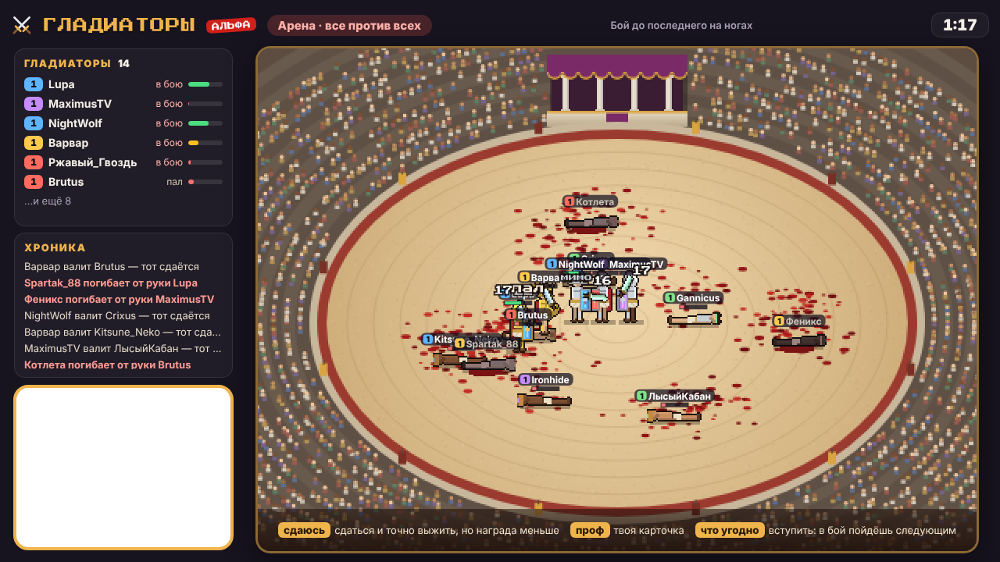
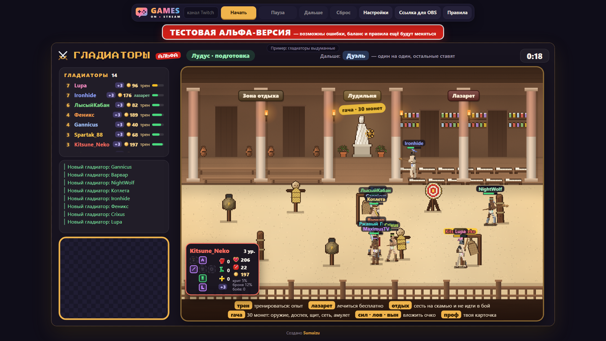
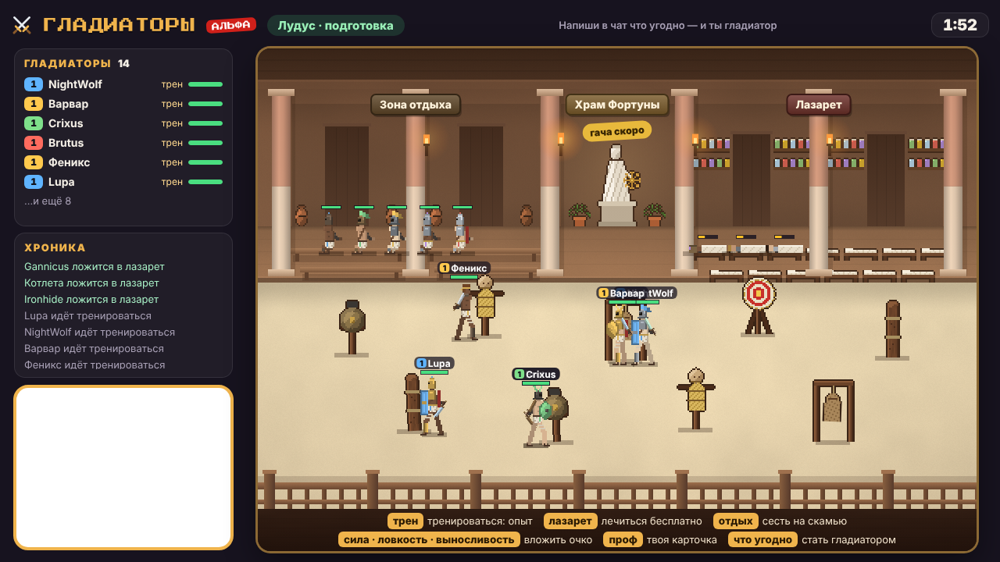
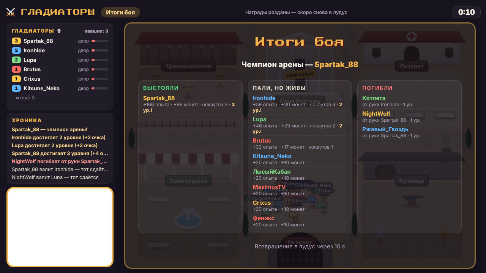
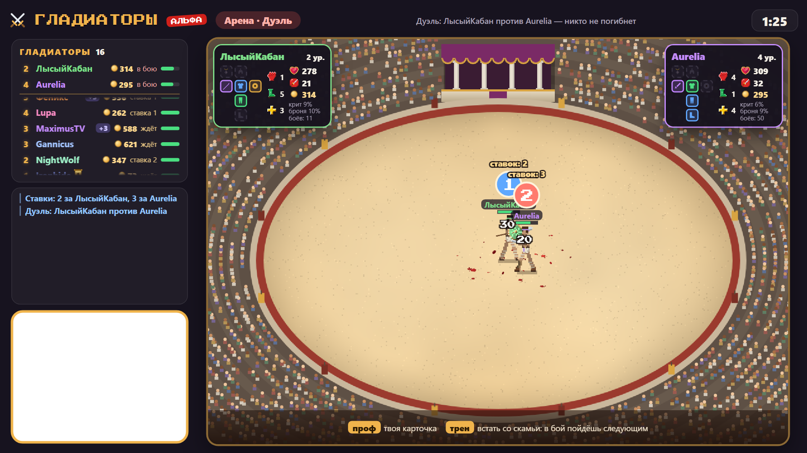
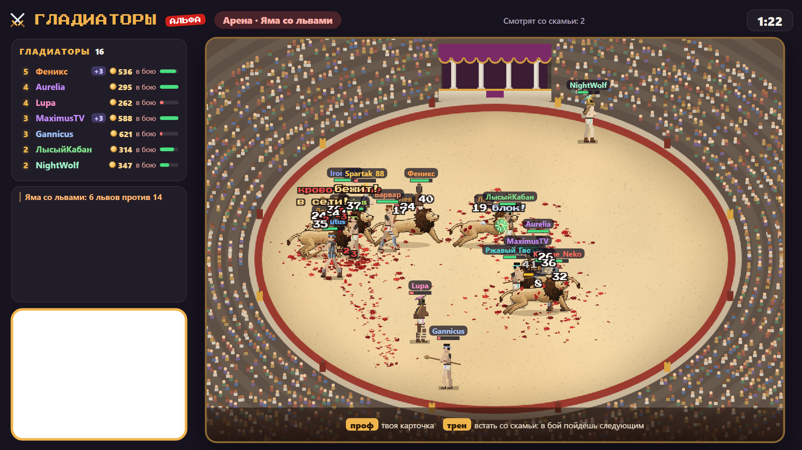

# Гладиаторы

**Тестовая альфа-версия** — возможны ошибки, баланс и правила ещё будут меняться.

Игра для чата Twitch на русском языке. Зрители пишут в чат — и становятся гладиаторами: готовятся к бою в лудусе,
а потом выходят на арену. Бои бывают разные: все против всех, стенка на стенку, дуэль со ставками, яма со львами.
Опыт, монеты и снаряжение копятся от боя к бою — но погибший гладиатор пропадает навсегда.



**[gamesonstream.ru/gladiatory](https://gamesonstream.ru/gladiatory/)** — играй прямо в браузере или вставь ссылку в
OBS.

Ставить ничего не нужно: ни программ, ни регистрации, ни ключей Twitch. Зрителям тоже — они играют, просто написав в
чат.

## Как запустить



При каждом открытии страницы поверх игры появляется окно с правилами для стримера: как запустить, как идёт игра,
команды зрителей и свои. Закрывается крестиком или кнопкой «Закрыть», снова открывается кнопкой «Правила» в шапке.

**В браузере.** Открой [gamesonstream.ru/gladiatory](https://gamesonstream.ru/gladiatory/), впиши сверху свой канал
Twitch и нажми «Начать». Сразу откроется лудус. Пока игра не начата, на её месте пример с выдуманными гладиаторами.

Рядом с «Начать» — ещё три кнопки:

- **«Пауза»** замораживает игру. «Продолжить» возвращает её с того же места.
- **«Дальше»** не ждёт конца отсчёта: сразу бой, итоги или лудус.
- **«Сброс»** стирает всех гладиаторов канала. Нажать нужно дважды — чтобы не задеть случайно.

**В OBS.** На той же странице нажми «Ссылка для OBS», скопируй ссылку и вставь её в источник «Браузер»: ширина 1920,
высота 1080. Игра начнётся сама, как только источник появится на экране.

Кнопка «Настройки» открывает панель рядом с игрой. Сохранять ничего не нужно: правки сразу действуют на игру в
браузере, а ссылка для OBS обновляется сама.

Что полезно знать про OBS:

- **Сцены.** Скрыл источник или ушёл на другую сцену — игра встала на паузу. Вернулся — игра продолжается с того же
  места.
- **Вебка.** Окошко под вебку прозрачное: источник с камерой поставь в OBS под оверлей и подгони под рамку.
  Окошко во всех играх Games on Stream стоит в одном месте — при смене игры камеру двигать не нужно. Для витуберов
  есть режим «Витубер»: окошко вертикальное, 420×540 в источнике 1920×1080, — туда помещается моделька из VTube
  Studio.
- **Звук** идёт из источника. Чтобы у игры была своя дорожка в микшере, включи в свойствах источника «Управление
  аудио через OBS».
- **Настройки зашиты в ссылку.** Поменял настройки — вставь в OBS новую ссылку.
- **Статистика.** Игра сообщает сайту название канала и время игры — только для статистики автора, кто играет.
- **Гладиаторы хранятся в OBS** (в браузере источника), отдельно для каждого канала. Нужна игра в нескольких сценах —
  добавляй тот же источник («Добавить существующий»), а не новый.
- **Обновления.** Оверлей сам замечает, что игра обновилась, и перезагружается — только между боями.

## Как играть



1. **Лудус** (минута, меняется в настройках). Напиши в чат что угодно — и ты гладиатор: 100 монет и 3 очка
   характеристик. Пока идёт отсчёт, гладиаторы тренируются, лечатся, крутят гачу и вкладывают очки. Какой будет бой,
   написано вверху: «Дальше: …». Команды написаны внизу экрана.
2. **Бой** (до полутора минут, тоже настраивается). Гладиаторы выходят на арену и дерутся сами: охотнее нападают на
   тех, кто выше уровнем, добивают раненых, мстят ударившему сбоку, а от крита или тяжёлых ран на время убегают.
   Сдаться нельзя — гладиатор падает сам, когда кончается здоровье. Кто сидит на скамье, в бой не выходит.
3. **Итоги.** Выстоявшие получают опыт и монеты, павшие, но живые, — немного меньше; последний на ногах — чемпион и
   получает на четверть больше. Сверху всем — по 3 опыта и 2 монеты за каждый удар по врагу. Чем больше гладиаторов
   на арене, тем щедрее награда. Потом все возвращаются в лудус, раненых сразу уносят в лазарет.



### Какие бывают бои

Какой будет следующий бой, решается в начале лудуса:

| Бой | Шанс | Что это |
| --- | --- | --- |
| Все против всех | 33% | Каждый сам за себя. Бой кончается, когда на ногах остался один или вышло время |
| Стенка на стенку | 33% | Красные против синих: команды случайные, но поровну (при нечётном числе в одной на одного больше). Ники в бою — цвета команды |
| Дуэль | 23% | Один на один со ставками, без смертей |
| Яма со львами | 11% | Все гладиаторы вместе против львов |
| Испытание парагона | вне очереди | Один против всех — когда кто-то до него дорос |

**Стенка на стенку.** Бой идёт, пока на ногах есть обе команды; погибнуть можно. Победившей команде — больше опыта и
золота, проигравшей — меньше, а тем, кто устоял на ногах, — ещё больше; по сумме — как обычный бой.



**Дуэль.** Первый боец — случайный, он встаёт слева. Справа — ближайший к нему по силе: сила считается из уровня,
характеристик, оружия и доспехов, а среди почти равных противник выбирается случайно. 30 секунд остальные ставят
`1` за левого или `2` за правого (ставить можно и со скамьи). Потом бой, в котором никто не погибает. Оба бойца
получают много опыта, победитель — ещё 30 монет за каждую ставку против себя, а все, кто угадал, — по 100 монет.
Пока идёт дуэль, оба бойца закреплены вверху списка гладиаторов, а во время боя их карточки — в верхних углах
арены.



**Яма со львами.** Лев на каждые 2,5 бойца (от 1 до 6), а сила львов (здоровье и урон) подстраивается под команду:
сила стороны — сумма урона в секунду × сумма живучести с бронёй, уклонением, щитом и с учётом текущего здоровья
(раненые не долечились). Подобрано симуляцией так, что гладиаторы побеждают примерно в 9 боях из 10, но с потерями.
От лап льва гибнут вдвое чаще, зато выжившие получают много опыта и золота.

**Испытание парагона.** Дорос до 10 уровня и провёл не меньше 30 боёв — следующий бой выходишь один против всех:
сети и кровотечение тебя не берут, не убегаешь ни от критов, ни от тяжёлых ран, а здоровье и урон в этом бою удваиваются. Выжившим против
тебя — много опыта. Ты сам, как бы ни кончился бой, получаешь парагон — золотой флажок с цифрой у ника, как в
Чатобороне, — и начинаешь заново с 1 уровня, без вещей и монет. Каждый парагон даёт +1 к стартовым очкам
характеристик и +10 к стартовому золоту и остаётся даже после гибели.

### Раны и смерть

- **Поражение.** Гладиатор без здоровья падает. Обычно он выживает, но может получить смертельную травму и погибнуть
  (по умолчанию 10%, меняется в настройках). Очень сильный добивающий удар поднимает шанс гибели не больше чем в
  1,25 раза, а добивание критом — в полтора раза. Погибший пропадает со всем прогрессом; написав в чат снова, зритель
  начинает новым бойцом 1 уровня.
- **Кровотечение.** Крит с шансом 50% пускает кровь на 5 секунд: раненый двигается на четверть медленнее и на бегу
  теряет здоровье (за всё кровотечение — около 15%), а упав с кровотечением, гибнет в полтора раза чаще.
- **Божественный амулет** один раз спасает от смерти: гладиатор вместо гибели просто падает, а амулет рассыпается.

## Лудус

- **Тренировка** (`трен`) — на песке посреди лудуса: гладиатор бьёт чучела и получает опыт, но не лечится. Новичок
  сразу идёт сюда.
- **Лазарет** — бесплатно и постепенно лечит, гораздо быстрее отдыха. Команды для него нет: после боя раненых уносят
  сюда сами, вылечился — идёт тренироваться.
- **Зона отдыха** (`отдых`) — гладиатор сидит на скамье и пропускает бои: смотрит со стороны (на дуэль ставить
  можно), раны затягиваются медленно. Сюда же сами садятся афк — кто 3 раунда подряд ничего не писал в чат; написал
  что угодно — снова в лазарет или на тренировку. Кто на скамье, того в списке гладиаторов не видно — только в общем
  числе.
- **Лудильня** (`гача`) — гача за 30 монет, монеты снимаются в момент прокрутки. В последние 5 секунд перед боем и во
  время боя гача не крутится — очередь ждёт.

**Что выпадает в гаче.** Оружие (меч, двуручный меч, копьё, секира, молот, трезубец) и доспехи (шлем, броня, поножи,
сапоги) пяти редкостей — в тех же пропорциях, что в Чатобороне: обычная 27 : редкая 20 : мифическая 10 : эпическая 7 :
легендарная 6. Ещё бывают щит, сеть и мешок с песком (по 15%, а с одноручным оружием и пустой второй рукой — по 20%) и
божественный амулет (3%). Пустых круток не бывает. Оружие той же редкости или выше заменяет старое, даже если урон
меньше; доспех надевается, только если он крепче. Надел двуручное — щит, сеть или мешок из второй руки пропадают.

**Характеристики.** За каждый уровень — 2 очка. Сила — больше урона; ловкость — чаще бьёт, быстрее бегает,
уворачивается и критует (сверх потолка уворота растёт только крит); выносливость — +25 здоровья за очко.

## Оружие и снаряжение

- **Кулаки** — с ними начинает каждый новичок: слабее, но чуть чаще. Первая гача гарантированно даёт оружие.
- **Меч** — урон ×1,15, бьёт чуть чаще остальных (удар на 10% быстрее).
- **Двуручный меч** — урон ×2,1, но бьёт в 1,5 раза реже; чаще критует и бьёт всех перед собой (сектор 100° длиной в
  полтора маха). Щит с ним не работает.
- **Копьё** — урон ×1,3, бьёт дальше и пробивает пятую часть брони. Его метают в далёкую цель и в израненного беглеца:
  брошенное, оно вдвое чаще критует, на 20% чаще промахивается, бьёт в 1,7 раза сильнее и пробивает половину брони, — а потом бегут подбирать.
  Снова метнуть можно через 5 секунд после подбора.
- **Секира** — двуручная: урон ×2,15, бьёт в 1,5 раза реже. Удар, отбитый щитом, раскалывает щит с шансом 60%.
- **Молот** — двуручный: урон ×2,5, бьёт в 1,5 раза реже и на 12% чаще промахивается, зато с шансом 35% оглушает на
  1,5 секунды — над головой звёздочки, оглушённый не бьёт, не уворачивается и не прикрывается щитом. Парагона в
  испытании не оглушить.
- **Трезубец** — одноручный: урон ×1,2, бьёт дальше меча и с шансом 15% выбивает у врага оружие из рук — оно улетает
  на 120–200 пикселей, и обезоруженный дерётся кулаками, пока не подберёт.
- **Щит** (без редкости, во второй руке) — отбивает примерно каждый пятый удар (20%) и раскалывается при этом с
  шансом 10%, а если отбит удар, который был бы критом, — 20%.
- **Сеть** (без редкости, во второй руке) — её бросают во врага: он запутан на 2 секунды — не бьёт и не может убежать,
  — и его добивают. Через 7 секунд сеть можно бросить снова, но после каждого броска она с шансом 15% рвётся.
- **Мешок с песком** (без редкости, во второй руке, одноразовый) — его бросают в цель, вокруг которой толпятся враги:
  мешок лопается песочной вспышкой, и все враги бросившего в 70 пикселях от места попадания слепнут на 5 секунд (у них на глазах песчаная повязка) и промахиваются на 50% чаще.
- **Доспехи** — шлем, броня, поножи и сапоги, каждое в свой слот; вместе режут урон, но не больше чем на 60%.
- **Божественные вещи** (красные) — в гаче не выпадают: кто убил гладиатора насмерть, у того одна легендарная вещь
  становится божественной (сперва оружие, иначе случайный легендарный доспех). Убил чужим оружием — оружие (ни чужое,
  ни своё) не качается, только доспех. Сила вещи ×1,5, гача её больше не меняет — до смерти или парагона.
- **Божественный амулет** — красный камень на груди. Один раз спасает от смерти; пока он есть, второй не выпадает.
- **Вторая рука** держит что-то одно: щит, сеть или мешок с песком. Пока она занята или в руках двуручное оружие,
  ничего из этого гача не даёт.

### Оружие на песке

- **Что падает.** У упавших и погибших оружие, щит, сеть и мешок с песком падают рядом; выбитое трезубцем улетает
  далеко; брошенное копьё лежит, где упало.
- **Кто поднимает.** Любой гладиатор: оружие — если оно лучше своего (урон в секунду × живучесть хотя бы на 10% больше),
  а до него хотя бы вдвое ближе, чем до ближайшего врага; решается он не сразу, а с шансом. Своё оружие он при этом
  бросает на песок. Щит, сеть и мешок поднимают, только если вторая рука свободна.
- **Без оружия** (метнул копьё, выбили трезубцем) гладиатор бежит к ближайшему оружию, которое хотя бы вдвое не хуже
  прежнего, а нет такого — за своим. Пока не нашёл — дерётся кулаками.
- **После боя** всё возвращается владельцам, как было до боя, — кроме расколотых щитов, порванных сетей и брошенного
  песка.

## Команды в чате

Для всех:

```
что угодно            стать гладиатором: 100 монет и 3 очка характеристик
трен                  тренироваться: опыт; во время боя — встать со скамьи и пойти в следующий бой
отдых                 сесть на скамью и пропускать бои
гача                  оружие, доспех, щит, сеть, мешок с песком или амулет за 30 монет; «гача 3» — три раза,
                      «гача все» — на все монеты (не больше 10 за раз)
сил · лов · вын       вложить очко в силу, ловкость или выносливость; «сил 3» — три очка, «сил все» — все
проф                  своя карточка на экране
1 или 2               в дуэли, пока идут ставки: ставка на левого или правого бойца
```

Для стримера и модераторов:

```
!гладиаторы-пауза     пауза, ещё раз — продолжить
!гладиаторы-дальше    не ждать отсчёта: сразу бой, итоги или лудус
!гладиаторы-сброс     стереть всех гладиаторов канала
```

## Настройки

| Настройка | По умолчанию | Что делает |
| --- | --- | --- |
| Канал Twitch | — | Чей чат читать: логин или ссылка на канал |
| Лудус | 60 с | Сколько длится подготовка перед каждым боем |
| Бой | 90 с | Сколько длится бой, не дольше; кончится раньше, если на ногах остался один |
| Шанс гибели | 10% | Шанс, что упавший гладиатор погибнет; 0 — никто не гибнет |
| Команды для стримера и модераторов | включены | `!гладиаторы-пауза`, `-дальше`, `-сброс` |
| Звуки и громкость | включены, 70% | Удары, криты, блоки, падения и гибель, рёв трибун и львов, гача, уровень, отсчёт перед боем |
| Окошко под вебку | с вебкой | «Без вебки» — окошка нет; «Витубер» — окошко вертикальное |

Значения по умолчанию — рекомендуемые: с ними страница открывается в первый раз, к ним же возвращает кнопка
«Рекомендуемые настройки».

## Что на экране

- **Поле** — лудус или арена, всё пиксельное. В лудусе гладиаторы бьют чучела, лежат в лазарете и сидят на скамьях;
  на арене дерутся под гул трибун, на песке остаются пятна крови. Над головой — ник и полоска здоровья, над схваткой
  всплывают урон, «блок!», «мимо», «кровотечение», «бежит!».
- **Сверху** — что сейчас (лудус, какой бой, итоги), какой бой будет дальше или что делать, и отсчёт.
- **Слева сверху — список гладиаторов**: уровень, ник, флажок парагона, свободные очки, монеты, где гладиатор и
  сколько у него здоровья. Сидящих на скамье в списке нет, но в общем числе они есть. Не влезли — список стоит
  наверху, плавно едет вниз, стоит внизу и снова появляется сверху. На дуэли оба бойца закреплены вверху, под чертой.
- **Слева посередине — хроника**: только важное — новые гладиаторы, начало боя, кто кого повалил и убил, уровни,
  парагон, легендарные вещи, амулет, щит, сеть и мешок с песком из гачи, итог боя. Новое сообщение въезжает сверху, старые плавно
  съезжают вниз; у каждого вида свой цвет. Длинное сообщение переносится, а цветная полоска слева показывает, где
  оно начинается и кончается.
- **Слева внизу** — окошко под вебку.
- **Карточка** (`проф`) — снаряжение куклой (шлем, броня, поножи, сапоги сверху вниз, правая рука слева от брони,
  левая справа, амулет над правой рукой), сила, ловкость, выносливость и свободные очки, здоровье, урон, монеты,
  крит, броня и сколько боёв за плечами.
- **Гача** — барабан над лудильней: кто крутит, что выпало и сколько круток ещё в очереди.
- **Внизу** — команды для зрителей.
- **Автор игры на арене.** Ник разработчика (Sumaizu на Twitch) вшит в игру: если он заглянет на стрим и вступит, его
  ник будет переливаться радугой. Ещё у нескольких зрителей и стримеров, которых отметил автор, свой цвет ника.

## Как считался баланс

Числа подобраны не на глаз: рядом с игрой лежит симулятор (`python tools/sim.py`) — те же бои, что в игре, только без
экрана и в сотни раз быстрее. Что он показывает сейчас:

- **Оружие.** Если у одноручного оружия во второй руке щит, сеть или мешок с песком (так почти всегда и бывает), то
  один на один каждое оружие выигрывает 44–54% боёв против остальных на 3, 6 и 12 уровне. В свалке «все против всех»
  чемпионом каждое оружие становится в 11–21% боёв (поровну — 17%). Копьё к высоким уровням чуть сильнее (58%) — оно
  пробивает броню.
- **Вторая рука.** Щит, сеть или мешок дают ощутимое преимущество, но не решают бой: меч со щитом против двуручника —
  примерно 50 на 50, против меча с пустой рукой — около 75%.
- **Характеристики.** Сборки с упором в одну характеристику (половина очков в неё) примерно равны на 5, 10 и 20 уровне;
  всё в одну — проигрывает любой смешанной.
- **Львы.** Гладиаторы побеждают в 88–96% боёв в яме — новички и ветераны, втроём и вдесятером.
- **Парагон** в испытании почти всегда выстаивает против четверых новичков и почти всегда падает против шестерых и
  больше гладиаторов средней силы.

## Для разработчиков

Игра — статические страницы на чистом JavaScript: без сборки и без сторонних библиотек.

```
site/index.html        главная страница: игра в браузере, настройки, ссылка для OBS
site/overlay.html      оверлей
site/js/page.js        главная страница
site/js/rules.js       правила для стримера в окне на главной странице
site/js/overlay.js     запуск оверлея: сам по себе в OBS или внутри главной страницы
site/js/engine.js      игра: лудус, бои, команды чата, гача, награды, хроника
site/js/balance.js     числа: характеристики, оружие, режимы боёв, львы, мощь бойца для дуэли
site/js/gacha.js       гача: редкости, вещи, шансы
site/js/places.js      места в лудусе и на арене
site/js/view.js        отрисовка оверлея: список, хроника, карточки, гача, итоги
site/js/draw.js        поле на холсте: лудус, арена, трибуны, гладиаторы, львы
site/js/art.js         пиксельные рисунки
site/js/chat.js        чтение чата Twitch без токена
site/js/config.js      настройки и их упаковка в ссылку
site/js/sound.js       звуки
site/js/stars.js       особые ники
site/js/demo.js        пример, который виден, пока игра не начата
tests/js/              тесты
tools/                 локальный сервер, тесты, симулятор баланса, снимки для README, кадры анимаций оружия
```

Запустить у себя — `site.bat` или `python tools/serve.py`: откроется `http://127.0.0.1:8773/`. Нужен Python 3.9
или новее.

Тесты идут в скрытом браузере (Edge или Chrome), в сеть при этом не ходят:

```
pip install websocket-client
python tools/jstest.py
```

Симулятор баланса — `python tools/sim.py` (или один опыт: `python tools/sim.py real`). Картинки для этой
страницы снимает `python tools/shots.py`, а позы и замахи всего оружия по кадрам (и в GIF) — `python tools/anims.py`.

Сайт выкладывается на GitHub Pages сам: когда в ветку `main` приходят изменения в папке `site/`, она публикуется
целиком (`.github/workflows/pages.yml`).

## Лицензия

Играть на своих стримах можно свободно — в том числе на стримах с донатами, подписками и рекламой.

Код открыт только для некоммерческого использования — лицензия
[PolyForm Noncommercial 1.0.0](LICENSE.md). Его можно читать, копировать и менять для себя. Продавать игру, её копии
и переделки, брать плату за доступ к ним и зарабатывать на них любым другим способом без разрешения автора нельзя.
За разрешением — к автору: [twitch.tv/sumaizu](https://twitch.tv/sumaizu).

Проект не связан с Twitch.
